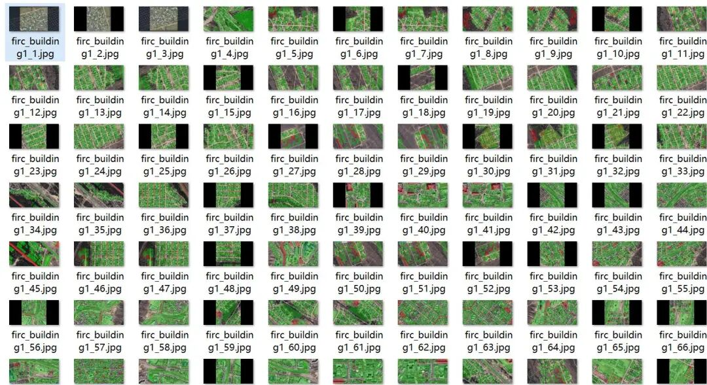
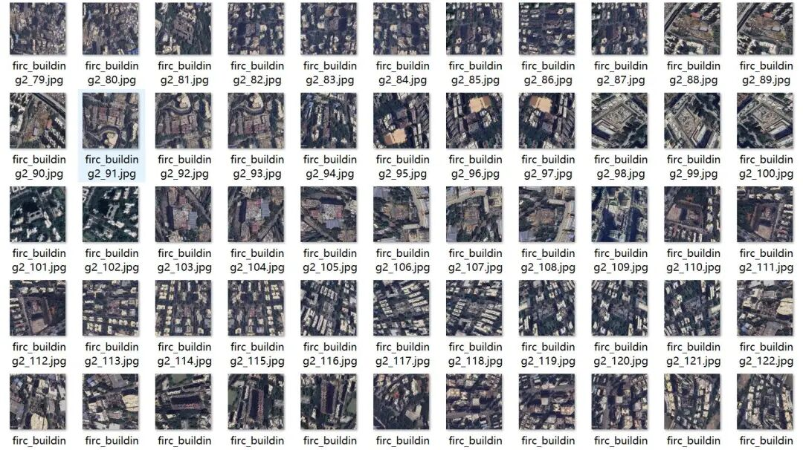
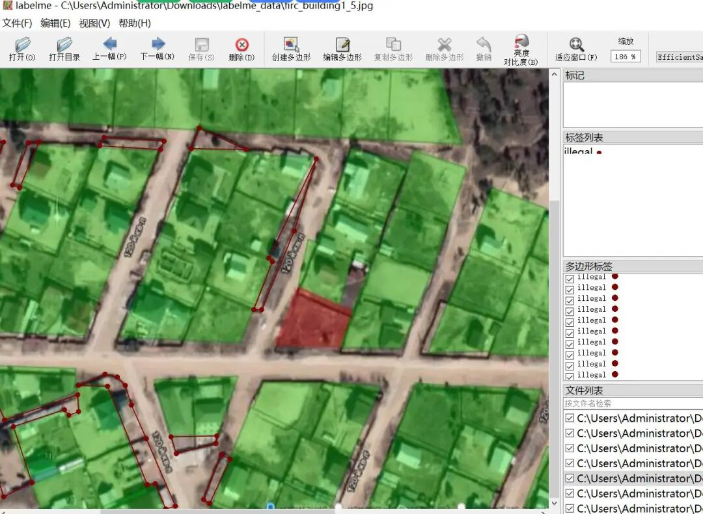
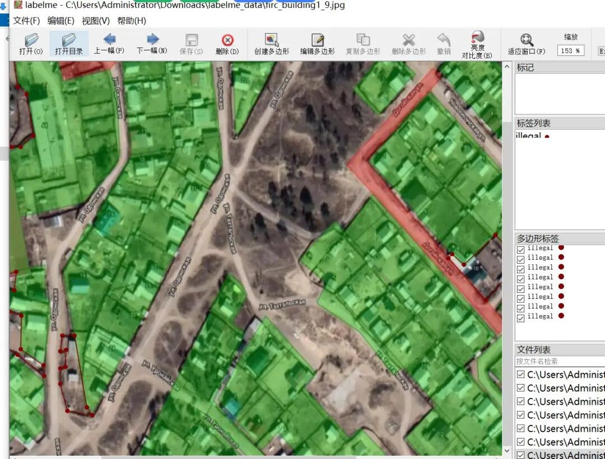
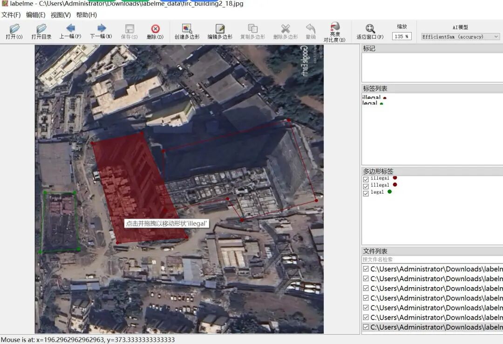
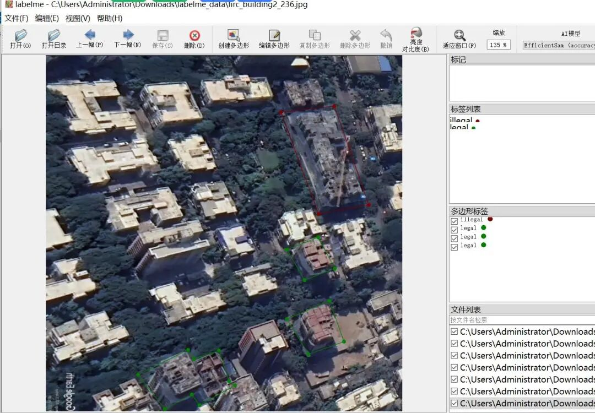

# Drone-based Illegal Building Segmentation Dataset in LabelMe format: 343 images, 2 classes

Dataset format: labelme format (without mask files, only including jpg images and corresponding json files)

Number of images (number of jpg files): 343

Number of annotations (number of json files): 343

Labeling category count: 2

Annotation category name: ["illegal", "legal"]

Number of boxes labeled in each category:

illegal count = 1242

legal count = 191

Using labeling tool: labelme=5.5.0

Image resolution: 98 images are 1280x640, and 145 images are 640x640.

Data augmentation: with augmentation, 45 out of 98 images are enhanced, while the remaining 145 images are from a different set without augmentation.

Annotation rules: Draw polygons around the categories.

Important Notice: The dataset can be opened and edited using LabelMe. For JSON datasets, one must convert them into mask or Yolo formats for semantic segmentation or instance segmentation.

Special : This dataset does not guarantee the accuracy of the trained models or weight files.

Image Preview:

Annotation example:

## Payment

Here is a pay link on Stripe ( https://buy.stripe.com/3cs8yP7sY87d0vu9AB ). Please contact me lonlonago@foxmail.com after funding $89, and I will send you a complete data files , thank you!

